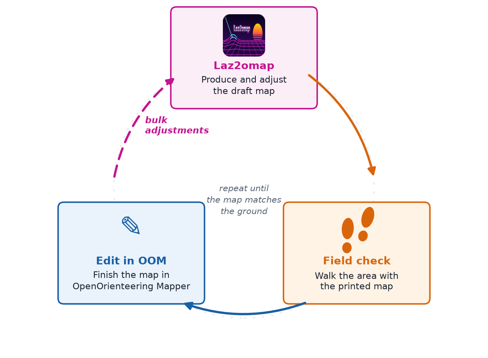

# Laz2omap

**Draft orienteering maps from lidar, for OpenOrienteering Mapper.**
Laz2omap finds the lidar of your area, downloads it, and makes a draft map (ISOM 2017-2 / ISSprOM 2019) that you
then check in the field and finish in OpenOrienteering Mapper.

## Download (Windows)

**[⬇ Download the latest Laz2omap-Setup.exe](https://github.com/laz2omap/laz2omap/releases/latest)**

1. On the release page, under **Assets**, click **Laz2omap-Setup-X.Y.Z.exe**.
2. Double-click it. If Windows shows *Windows protected your PC*, click **More info → Run anyway**.
3. Click **Next**, then **Install**. Laz2omap opens; next time, start it from the desktop or the Start menu.

No administrator password, nothing else to install. Your maps and settings go in **Documents\Laz2omap**.
To update, run the newer Setup: your lidar, maps and settings stay.

**Windows only for now.** Want it on Linux or macOS? [Ask for it here](https://github.com/laz2omap/laz2omap/issues/new?template=1-idea.yml&title=Linux%20%2F%20macOS%20version&labels=enhancement,platform): requests decide what comes next.

The guides (English cheat sheet and French *pense-bête*) are on the same release page, and in the Start menu once
Laz2omap is installed.

## Téléchargement (Windows)

**[⬇ Télécharger le dernier Laz2omap-Setup.exe](https://github.com/laz2omap/laz2omap/releases/latest)**

1. Sur la page de la version, sous **Assets**, cliquez **Laz2omap-Setup-X.Y.Z.exe**.
2. Double-cliquez-le. Si Windows affiche *Windows a protégé votre ordinateur*, cliquez **Informations
   complémentaires → Exécuter quand même**.
3. Cliquez **Suivant**, puis **Installer**. Laz2omap s'ouvre ; ensuite, lancez-le depuis le Bureau ou le menu Démarrer.

Pas de mot de passe administrateur, rien d'autre à installer. Vos cartes et réglages vont dans **Documents\Laz2omap**.
Pour mettre à jour, lancez le Setup plus récent : votre lidar, vos cartes et vos réglages restent.

**Windows seulement pour l'instant.** Vous le voulez sur Linux ou macOS ? [Demandez-le ici](https://github.com/laz2omap/laz2omap/issues/new?template=1-idea.yml&title=Linux%20%2F%20macOS%20version&labels=enhancement,platform) : les demandes décident de la suite.

## Ideas or problems? / Des idées ou un problème ?

**[💡 Suggest an idea / Proposer une idée](https://github.com/laz2omap/laz2omap/issues/new?template=1-idea.yml)**
&nbsp;·&nbsp;
**[🐞 Report a problem / Signaler un problème](https://github.com/laz2omap/laz2omap/issues/new?template=2-problem.yml)**
&nbsp;·&nbsp;
**[🌍 Request a country / Demander un pays](https://github.com/laz2omap/laz2omap/issues/new?template=3-country.yml)**

A short form opens (a free GitHub account is needed to send it). English or French. See what others asked in
[Issues](https://github.com/laz2omap/laz2omap/issues). / Un court formulaire s'ouvre (un compte GitHub gratuit est
nécessaire pour l'envoyer). En anglais ou en français.

## Where the lidar comes from

Automatic download: Québec, the rest of Canada (NRCan, Ontario FRI), the USA (USGS 3DEP), Poland, France, Denmark,
Saxony, England, Switzerland, Estonia, Lithuania, Spain and Finland (pink on Laz2omap's map). In many other countries
(blue) it lists where to get the lidar and takes your own .laz tiles.

**Your country missing, or better lidar elsewhere? [🌍 Request a country](https://github.com/laz2omap/laz2omap/issues/new?template=3-country.yml).** / **Votre pays manque, ou un
meilleur lidar existe ailleurs ? [🌍 Demandez un pays](https://github.com/laz2omap/laz2omap/issues/new?template=3-country.yml).**

## Licence

Laz2omap: PolyForm Noncommercial 1.0.0 (free for clubs, events and personal use; commercial use needs a separate
licence). Guides: CC BY-NC 4.0. © 2026 Jerome Grenier Desbiens.
